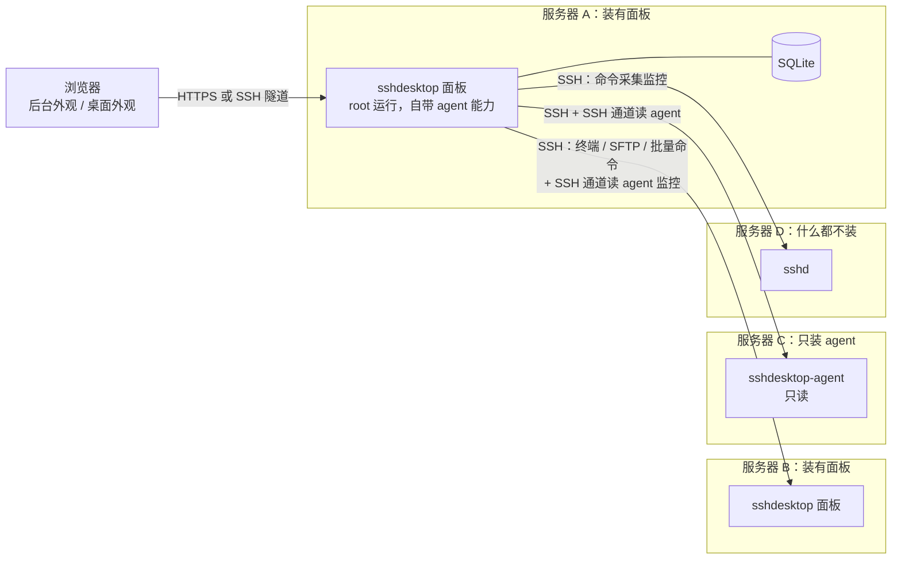

# sshDesktop 设计文档

| 项目 | 内容 |
| --- | --- |
| 状态 | 已确认（2026-10-20，PR #1 合并），作为实现依据 |
| 版本 | 未设版本（设计阶段） |
| 更新时间 | 2026-10-20 16:30 +08:00 |
| 需求来源 | [需求讨论记录](requirements.md) |

## 1. 概述

### 1.1 目标

sshDesktop 是一个装在 Linux 服务器上的 Web 管理面板。它结合 1Panel 的主机管理能力和哪吒探针的多机监控能力，并提供两种外观：

- **后台外观**：传统的侧边栏 + 页面布局，适合快速操作和手机访问。
- **桌面外观**：在浏览器里渲染一个 Windows 11 风格的桌面（任务栏、开始菜单、可拖拽窗口、文件资源管理器），让用户用操作 PC 的方式管理服务器。

两种外观共用同一套功能模块，随时切换。

### 1.2 使用场景与规模

- 自用或小团队，约 5 台服务器。
- 每台服务器可以装一个面板（管本机），也可以只装轻量 agent（只提供监控数据），也可以什么都不装（通过 SSH 管理）。
- 任意一个面板都可以作为"中心面板"，通过 SSH 对其他服务器做轻量操作：监控、文件、终端、批量命令。

### 1.3 非目标

- 不做 VNC / RDP 等真实远程图形桌面串流。
- 不做 agent 主动连回面板的反向连接（所有服务器都有公网 IP，可直接 SSH）。
- 首版不做 macOS 风格、两步验证、告警推送、数据库管理、状态页、DDNS（见第 11 节）。

### 1.4 术语

| 术语 | 含义 |
| --- | --- |
| 面板 | `sshdesktop` 主程序，装在服务器上，以 root 运行，管理本机，同时可作为中心面板管理其他服务器 |
| 本机 | 面板所在的服务器 |
| 节点 | 面板管理的一台服务器，包括本机和通过 SSH 添加的远程服务器 |
| agent | 只读的轻量监控程序 `sshdesktop-agent`；面板自带 agent 能力 |
| 应用（App） | 一个功能模块在前端的封装，例如"文件资源管理器""终端""监控"；在桌面外观里是一个窗口，在后台外观里是一个页面 |
| 危险操作 | 需要用户确认才能执行的操作，分为两级（见 8.6） |

## 2. 需求摘要

完整讨论过程见 [requirements.md](requirements.md)，这里只列设计依据。

### 2.1 职责划分

| 组件 | 职责 | 权限 |
| --- | --- | --- |
| 面板 | 本机全部管理操作；作为中心面板管理其他节点的轻量功能 | 本机 root |
| agent | 只采集、只读：系统指标、流量计数、基础进程概况 | 只暴露普通用户本来就能从 `/proc` 读到的信息 |
| SSH | 中心面板对远程节点的监控（无 agent 时）、文件（SFTP）、终端、批量命令 | 等于所用 SSH 账号的权限 |

### 2.2 功能分级

| 级别 | 功能 |
| --- | --- |
| P0 首版 | 监控概览（实时 + 历史）、文件管理器、多窗口终端、进程与系统服务、Docker 容器与 Compose、计划任务、账号与功能权限、操作审计、服务监控（HTTP / TCP / Ping / SSL 证书）、防火墙、SSH 设置、网站管理（Nginx 反向代理 + 自动证书）、应用商店、备份恢复、按月流量统计、多服务器批量命令 |
| P1 | 安全工具（Fail2ban 等）、AI 助手、通行密钥登录、macOS 风格 |
| P2 | 告警通知（Telegram、邮件、Webhook、企业微信等）、数据库管理、公开状态页、DDNS |

P0 体量较大，按第 11 节拆为 4 个里程碑交付，每个里程碑都能独立使用。

### 2.3 关键约束

- 默认端口 33333，安装时可改。
- 配置了域名和 HTTPS 才对公网开放；否则只接受本机连接（SSH 隧道可用）。
- 不做安全入口和两步验证；登录失败多次封 IP。
- 所有面板账号对服务器的操作都以 root 执行，只靠面板功能权限限制。
- 桌面风格先做 Windows 11；桌面状态保存在服务器上；手机访问自动用后台外观。
- 以 GPL-3.0 许可证开源（与 1Panel 相同，可直接复用其代码和应用商店）；通过 GitHub Releases 发布。
- 全面接管服务器上已有的 Nginx、Docker、防火墙、计划任务等；无法接管的部分给出兼容性提醒、注意事项和操作建议（见 7.18）。

## 3. 总体架构

### 3.1 部署拓扑



- 浏览器只和一个面板通信。面板 A 作为中心面板时，对 B、C、D 的所有访问都走 SSH。
- B 上的面板也可以反过来管理 A。两个面板互不依赖，各自保存自己的节点列表。
- agent 只在本机监听 Unix socket，不开任何网络端口。远程面板通过 SSH 的 `direct-streamlocal` 通道（OpenSSH 的 Unix socket 转发，默认开启）访问它。

### 3.2 程序组成

| 程序 | 说明 |
| --- | --- |
| `sshdesktop` | 面板主程序。单个静态二进制，内嵌前端资源；子命令包括 `server`（运行面板）、`cron run`（计划任务执行器）、`user` / `config` / `info` 等运维命令 |
| `sshdesktop-agent` | 独立 agent。单独编译，体积小、内存占用低，只包含采集和 socket 服务代码 |

面板进程内置与 agent 相同的采集模块，并在同一个 socket 路径上提供同样的 agent 接口。所以装了面板的服务器不需要再装 agent；如果先装了 agent、后装面板，安装脚本会停用独立 agent，由面板接管 socket。

### 3.3 技术选型

版本以 2026-10 查询到的最新稳定版为准，开工时再核对一次。

| 层 | 选型 | 理由 |
| --- | --- | --- |
| 后端语言 | Go 1.27 | 单文件部署、交叉编译 amd64 / arm64 方便；1Panel 和哪吒同为 Go |
| HTTP 框架 | Gin 1.12 | 生态成熟，中文资料多，1Panel 同款 |
| WebSocket | coder/websocket | 维护活跃，支持 context |
| 数据库 | SQLite + GORM 1.31，驱动 `ncruces/go-sqlite3/gormlite` | 纯 Go（无 CGO），交叉编译简单；5 台规模绰绰有余 |
| 系统信息 | gopsutil v4 | 跨发行版采集 CPU、内存、磁盘、网络、进程 |
| SSH / SFTP | `golang.org/x/crypto/ssh`、`pkg/sftp` | 事实标准 |
| 本机终端 | creack/pty | 事实标准 |
| Docker | `moby/moby/client`；Compose 调用 `docker compose` 命令 | 官方 SDK；Compose 走 CLI 与 1Panel 一致，兼容性最好 |
| 证书 | lego v4 | 支持 HTTP-01 和几十家 DNS 服务商的 DNS-01 |
| 命令行 | cobra | 子命令与帮助生成 |
| 前端框架 | Vue 3.5 + TypeScript + Vite 8 | 已确认 |
| 状态与路由 | Pinia、Vue Router | Vue 官方方案 |
| 组件库 | Naive UI | TypeScript 友好，主题变量可整体覆盖，便于做出 Fluent（Win11）风格 |
| 终端组件 | xterm.js 6 | 事实标准 |
| 代码编辑器 | CodeMirror 6 | 体积远小于 Monaco，按需加载语言包 |
| 图表 | ECharts 6 | 监控曲线、仪表盘 |
| 多语言 | vue-i18n | 首版只填中文 |

## 4. 节点与连接模型

### 4.1 节点类型

```go
// 所有功能模块只依赖这个接口，不关心节点是本机还是远程
type Node interface {
    ID() string
    Kind() NodeKind            // Local / SSH
    Exec(ctx, cmd) (Result, error)        // 执行命令
    Shell(ctx, size) (PTY, error)         // 交互终端
    FS() vfs.FS                           // 文件系统（本机直接读写 / 远程 SFTP）
    Metrics() MetricsSource               // 监控数据源（agent 或命令采集）
}
```

| 节点 | 文件 | 终端 | 监控来源 | 可用功能 |
| --- | --- | --- | --- | --- |
| 本机 | 直接读写 | pty | 内置采集模块 | 全部功能 |
| 远程，装有 agent 或面板 | SFTP | SSH | 经 SSH 通道读 agent | 监控（含历史、流量统计）、文件、终端、批量命令、服务监控 |
| 远程，什么都没装 | SFTP | SSH | 经 SSH 定时执行采集命令 | 同上，但监控历史只在面板连着时记录，没有按月流量统计 |

Docker、网站、防火墙、SSH 设置、计划任务、备份、应用商店这些高权限功能只对本机开放。要管理另一台服务器的这些功能，就打开那台服务器自己的面板。

### 4.2 添加远程节点

1. 填写地址、端口、用户名，选择认证方式（私钥或密码）。凭据加密后存入数据库（见 8.5）。
2. 首次连接时显示服务器的主机密钥指纹，用户确认后保存（与 PC 上第一次 SSH 连接的体验一致）。之后指纹变化会拒绝连接并醒目提示。
3. 连接成功后探测：系统信息、是否已有 agent socket、是否装有面板。
4. 没有 agent 时，节点卡片上提供"安装 agent"按钮：面板通过 SFTP 上传与对方架构匹配的 agent 二进制和 systemd 单元，远程服务器不需要访问外网。安装需要 SSH 账号是 root 或有 sudo 权限。

### 4.3 连接管理

- 每个远程节点维持一条 SSH 长连接，终端、SFTP、agent 通道、命令执行都复用它（SSH 多路复用）。
- 断线后指数退避重连；节点状态在桌面任务栏托盘和节点列表里实时显示。
- 并发上限：每节点同时最多 8 个 SFTP 传输、32 个通道，防止拖垮远程 sshd。

### 4.4 agent 接口

- 传输：Unix socket `/run/sshdesktop/agent.sock` 上的 HTTP/1.1 + JSON，长连接流式推送用分块传输（NDJSON）。
- 权限：socket 文件权限 0666，但只提供普通用户本来就能读到的信息（`/proc` 中的系统指标、网卡计数、进程名与资源占用），不提供命令行参数、环境变量、文件内容，也没有任何写接口。所以无论哪个面板、用哪个 SSH 账号来读，都不构成提权。
- 接口：

| 接口 | 说明 |
| --- | --- |
| `GET /v1/info` | 主机名、系统、内核、架构、CPU 型号、agent 版本 |
| `GET /v1/metrics/stream` | 每秒推送一次实时指标 |
| `GET /v1/metrics/history?from=&to=&step=` | 历史指标（用于面板补齐离线期间的数据） |
| `GET /v1/traffic?month=` | 按月流量统计 |
| `GET /v1/processes/top?n=` | 资源占用最高的进程（名称、PID、CPU、内存） |

- 本地存储：agent 在 `/var/lib/sshdesktop-agent/` 用一个小 SQLite 保存 7 天的分钟级指标和流量计数器，重启后流量统计不丢失。

### 4.5 无 agent 时的采集

面板在 SSH 连接上启动一个常驻的 `sh` 循环，每 5 秒读取 `/proc/stat`、`/proc/meminfo`、`/proc/loadavg`、`/proc/net/dev` 和 `df -P` 的输出，面板端解析成与 agent 相同的数据结构。只依赖 POSIX sh 和 `/proc`，兼容主流发行版。

## 5. 后端设计

### 5.1 仓库结构

```
sshDesktop/
├── cmd/
│   ├── sshdesktop/            # 面板主程序入口（cobra 子命令）
│   └── sshdesktop-agent/      # 独立 agent 入口
├── internal/
│   ├── server/                # HTTP 服务、路由、中间件、访问控制
│   ├── auth/                  # 登录、会话、封禁
│   ├── rbac/                  # 角色与功能权限
│   ├── audit/                 # 操作审计
│   ├── node/                  # 节点抽象：local、ssh；连接池
│   ├── agent/                 # 采集模块 + socket 服务（面板与独立 agent 共用）
│   ├── vfs/                   # 统一文件系统接口：local、sftp
│   ├── task/                  # 后台任务（进度、日志、取消）
│   ├── realtime/              # WebSocket 多路复用推送
│   ├── module/                # 各功能模块，每个子目录一个模块
│   │   ├── monitor/  files/  terminal/  process/  service/
│   │   ├── docker/  appstore/  cron/  backup/  website/  cert/
│   │   ├── firewall/  sshd/  probe/  traffic/  batch/
│   │   └── desktop/           # 桌面状态保存
│   ├── store/                 # 数据库、迁移、模型
│   └── config/                # 配置文件读写
├── web/                       # 前端（见第 6 节）
├── scripts/
│   └── install.sh             # 一键安装脚本
├── docs/
├── .github/workflows/         # CI
├── README.md
└── CHANGELOG.md
```

### 5.2 分层与约定

- 每个模块对外暴露 `Register(r *gin.RouterGroup, deps Deps)`，内部分为 handler（参数校验、权限声明）和 service（业务逻辑）两层。
- 所有涉及节点的接口路径都带节点 ID：`/api/v1/nodes/{nodeId}/files/...`。本机的节点 ID 固定为 `local`。
- 统一响应：`{ "code": 0, "message": "", "data": ... }`，错误码按模块分段，前端按错误码显示本地化文案。
- 耗时操作（安装应用、拉镜像、备份、申请证书、批量命令）一律走任务系统：接口立即返回任务 ID，进度和日志通过 WebSocket 推送，任务记录保存 30 天。
- 执行系统命令统一通过 `exec.Command` 传参数数组，禁止拼接 shell 字符串；必须经过 shell 的场景（用户在终端或批量命令里输入的命令）只在明确授权的功能里出现。

### 5.3 实时通信

- `/api/v1/ws`：每个浏览器标签页一条 WebSocket，按频道订阅：`metrics:{nodeId}`、`task:{taskId}`、`notify`、`node-status`。
- `/api/v1/nodes/{nodeId}/terminals/{sessionId}/ws`：每个终端一条独立 WebSocket，二进制帧传输终端数据。

### 5.4 终端会话

- 终端会话在服务端独立于 WebSocket 存在。关闭浏览器或刷新页面后，会话保留 30 分钟（可配置），重新打开时自动接回，并回放最近 1 MB 输出。这也是桌面状态恢复的基础。
- 分屏和"同步输入"在前端实现：一个输入框的按键同时写入多个会话。
- 会话结束后保留元数据（谁、何时、哪个节点、时长）进审计日志。完整录屏回放列为 P1 可选项。

### 5.5 配置与数据目录

| 路径 | 内容 |
| --- | --- |
| `/usr/local/bin/sshdesktop` | 面板二进制 |
| `/etc/sshdesktop/config.yaml` | 端口、监听地址、域名、证书、日志级别等启动配置 |
| `/var/lib/sshdesktop/sshdesktop.db` | 数据库 |
| `/var/lib/sshdesktop/secret.key` | 加密主密钥（0600） |
| `/var/lib/sshdesktop/apps/` | 应用商店安装的应用（compose 文件、数据目录） |
| `/var/lib/sshdesktop/backups/` | 本地备份 |
| `/var/log/sshdesktop/` | 运行日志（按天切割，保留 14 天） |
| `/run/sshdesktop/agent.sock` | agent 接口 |

### 5.6 数据库主要表

| 表 | 说明 |
| --- | --- |
| `users`、`roles`、`role_permissions`、`sessions`、`login_attempts`、`ip_bans` | 账号、权限、会话、防爆破 |
| `audit_logs` | 审计日志 |
| `nodes`、`node_credentials`、`node_host_keys` | 远程节点、加密凭据、主机指纹 |
| `metrics_1m`、`metrics_15m`、`metrics_1h` | 监控历史：分钟级保留 7 天，15 分钟级保留 90 天，小时级保留 2 年 |
| `traffic_monthly` | 按月流量（每个节点、每块网卡） |
| `probes`、`probe_results` | 服务监控 |
| `tasks`、`task_logs` | 后台任务 |
| `cron_jobs`、`cron_runs` | 计划任务 |
| `backup_targets`、`backup_plans`、`backup_records` | 备份 |
| `websites`、`certificates`、`dns_accounts` | 网站与证书 |
| `apps_installed` | 已安装应用 |
| `snippets` | 批量命令的常用命令片段 |
| `desktop_states` | 每个用户的桌面状态（JSON） |
| `settings` | 键值配置 |

## 6. 前端设计

### 6.1 目录结构

```
web/src/
├── apps/                  # 功能应用，两种外观共用
│   ├── explorer/          # 文件资源管理器
│   ├── terminal/
│   ├── monitor/
│   ├── ...
│   └── registry.ts        # 应用注册表
├── shells/
│   ├── admin/             # 后台外观：侧边栏 + 路由
│   └── desktop/           # 桌面外观：窗口管理器、任务栏、开始菜单、桌面、通知中心
├── components/            # 通用组件（确认框、文件选择器、图表等）
├── api/                   # 接口封装与类型
├── stores/                # Pinia
├── i18n/
└── theme/                 # Win11 主题变量（浅色 / 深色）
```

### 6.2 应用注册表

每个功能在 `registry.ts` 里登记一份清单，两种外观都从这里读取：

```ts
interface AppManifest {
  id: string                      // 'explorer'
  title: string                   // i18n key
  icon: string
  permission: string              // 打开该应用需要的权限点
  component: () => Promise<Component>   // 懒加载
  window: { width: number; height: number; minWidth?: number; singleton?: boolean }
  fileAssociations?: string[]     // 能打开的文件类型，用于"双击打开""打开方式"
  adminRoute?: string             // 后台外观中的路由
}
```

- 后台外观：侧边栏按清单生成菜单，每个应用一个页面。
- 桌面外观：开始菜单和桌面图标按清单生成，打开应用即创建窗口。
- 应用组件本身不知道自己在窗口里还是页面里，只通过注入的 `useAppHost()` 获取标题设置、关闭、打开其他应用等能力。

### 6.3 桌面外观（Windows 11 风格）

| 部件 | 设计 |
| --- | --- |
| 桌面 | 网格排列的图标，可拖动排序；右键菜单：新建文件夹 / 文件、刷新、显示设置、个性化；支持壁纸 |
| 任务栏 | 居中的开始按钮、搜索、固定的应用、运行中的窗口（带预览）；右侧托盘：节点连接状态、CPU / 网速小组件、通知中心、时钟 |
| 开始菜单 | 已固定、全部应用、搜索（应用 + 文件 + 设置项）；底部是当前用户（注销、切换到后台外观）和电源（重启 / 关机服务器，属于二级危险操作） |
| 窗口 | 拖动、八向缩放、最小化、最大化、关闭；双击标题栏最大化；拖到屏幕边缘贴靠半屏 / 四分之一屏；标题栏显示所属节点（远程节点用彩色标签区分） |
| 小组件面板 | 本机 CPU、内存、磁盘、网速、各节点在线状态 |
| 通知中心 | 后台任务进度和结果、服务监控异常、证书即将到期、节点断线；面板开着时右下角弹出提示 |
| 快捷键 | Win 键、`Alt+Tab`、`Alt+F4` 会被操作系统占用，因此改用其他组合：`Alt+E` 文件资源管理器、`Alt+T` 终端、`Alt+Q` 切换窗口、`Alt+W` 关闭窗口、`Alt+D` 显示桌面；`Ctrl+C/V/X`、`Delete`、`F2` 在资源管理器内操作文件 |
| 主题 | 浅色 / 深色，跟随系统或手动切换；Mica 风格半透明背景 |

### 6.4 文件资源管理器

- 左侧导航：快速访问、**此电脑**（本机的挂载点）、**网络**（每个远程节点一个"网络位置"，图标上显示在线状态）、回收站。
- 视图：大图标、列表、详细信息；排序、筛选、地址栏可直接输入路径。
- 操作：新建、重命名、删除（进回收站）、复制 / 剪切 / 粘贴（同节点直接操作，跨节点由面板中转流式传输，显示进度）、拖拽上传下载、压缩 / 解压（zip、tar.gz、tar.xz、7z 只解压）、修改权限和所有者、属性窗口（大小、权限、时间）、"在此处打开终端"。
- 双击：文本类用编辑器打开，图片 / 视频 / PDF 用预览窗口打开，压缩包进入解压对话框；其他类型下载。
- 回收站：本机按挂载点使用 `<挂载点>/.sshdesktop-trash/`，远程节点使用 SSH 账号家目录下的 `~/.sshdesktop-trash/`，记录原路径，可还原；默认 30 天自动清理。无法移入回收站时（例如跨文件系统且空间不足）改为二级确认后永久删除。

### 6.5 桌面状态保存

- 保存内容：打开的窗口（应用、位置、大小、层级、最小化 / 最大化、应用内部状态如当前目录和终端会话 ID）、桌面图标排列、固定到任务栏的应用、壁纸和主题。
- 前端变化后 2 秒防抖，写入 `PUT /api/v1/desktop/state`；登录后读取并恢复。
- 服务端按用户保存，换设备登录一致。不同分辨率下按比例缩放窗口并保证不超出屏幕。

### 6.6 后台外观与移动端

- 宽度小于 1024 px 或触屏设备默认进入后台外观；桌面外观入口在此时隐藏。
- 用户可以在设置里选择默认外观，开始菜单和后台顶部都有切换按钮。

## 7. 功能模块

各模块列出要点；P0 范围内的模块在里程碑计划里有对应的验收标准。权限点格式为 `模块:操作`，`view` 为只读，`manage` 为修改。

### 7.1 监控概览（`monitor`）

- 本机和各节点的 CPU、负载、内存、交换分区、磁盘使用与读写、网络收发、TCP 连接数、运行时间。
- 实时曲线（1 秒）和历史曲线（1 小时 / 1 天 / 7 天 / 30 天 / 自定义）。
- 多节点总览：卡片墙，每台服务器一张卡片，类似哪吒首页。
- 权限点：`monitor:view`。

### 7.2 按月流量统计（`traffic`）

- 每个节点、每块网卡的上行 / 下行 / 合计；可设置每月重置日和流量额度，显示已用百分比。
- 数据来自 agent 的持久化计数器；无 agent 的节点不提供此功能，并提示安装 agent。
- 权限点：`monitor:view`。

### 7.3 服务监控（`probe`）

- 类型：HTTP(S)（状态码、关键字、响应时间）、TCP 端口、Ping、SSL 证书到期。
- 由面板发起探测，间隔可设（最短 30 秒）；结果保存 30 天，展示可用率和延迟曲线。
- 异常和恢复事件进入通知中心。告警推送属于 P2。
- 权限点：`probe:view`、`probe:manage`。

### 7.4 文件管理（`files`）

见 6.4。后端接口按节点区分，本机直接读写，远程走 SFTP；大文件上传使用分片 + 断点续传，下载支持 Range。在线编辑保存前检查文件修改时间，防止覆盖他人修改。权限点：`files:view`、`files:manage`。

### 7.5 终端（`terminal`）

见 5.4。支持本机和任意远程节点；多标签、分屏、同步输入、字体和配色设置、常用命令片段。权限点：`terminal:use`（等同 root，界面上明确提示）。

### 7.6 批量命令（`batch`）

- 选择多个节点，输入命令或选择命令片段，并发执行（默认并发 5，可设超时），按节点分栏显示输出和退出码。
- 执行记录进入审计日志；属于一级危险操作，确认框列出所有目标节点。
- 权限点：`batch:run`。

### 7.7 进程与系统服务（`process`、`service`）

- 进程：列表（树形 / 平铺）、按 CPU / 内存排序、搜索、查看详情（命令行、打开的文件、网络连接）、结束进程（一级危险操作）。
- 系统服务：systemd 单元列表、状态、启动 / 停止 / 重启 / 开机自启、查看日志（journalctl 实时跟随）。
- 仅本机。权限点：`process:view`、`process:manage`。

### 7.8 Docker（`docker`）

- 容器：列表、创建、启停、删除、日志（实时）、进入容器终端、资源占用、端口与挂载查看。
- 镜像、网络、存储卷：列表、拉取、删除、清理未使用资源。
- Compose 项目：列表、从目录或粘贴 YAML 创建、启停、更新（pull + up）、编辑。
- 面板能看到并管理服务器上所有已有容器，不论是否由面板创建；已有的 Compose 项目通过容器标签 `com.docker.compose.project.working_dir` 识别，自动出现在 Compose 列表中。
- Docker 未安装时提供一键安装（官方安装脚本或发行版软件包）。
- 仅本机。权限点：`docker:view`、`docker:manage`。

### 7.9 应用商店（`appstore`）

- 应用以"应用定义"描述：元数据（名称、图标、分类、说明）、`docker-compose.yml` 模板、表单字段（端口、密码、数据目录等）。
- 安装：填写表单 → 渲染 compose → 拉取镜像（任务进度）→ 启动 → 可选一键创建网站反向代理。
- 已安装应用：启停、升级、查看日志、打开目录、卸载（可选保留数据）。
- 应用定义来源设计为可配置的"应用源"（Git 仓库或 HTTP 地址），格式兼容 1Panel 应用商店。默认应用源为 [1Panel 应用商店](https://github.com/1Panel-dev/appstore)（160 多个应用），用户可追加自己的应用源。
- 仅本机。权限点：`appstore:view`、`appstore:manage`。

### 7.10 网站管理（`website`、`cert`）

- 运行环境二选一，由环境体检（7.18）自动判断：
  - **接管已有 Nginx**：服务器上已有宿主机 Nginx（或 OpenResty）时，面板直接管理它。面板新建的站点写入独立目录 `/etc/nginx/conf.d/sshdesktop/`（或发行版对应位置），并在主配置中加一行 `include`。已有站点逐个解析：结构简单的（`server_name`、`listen`、`root`、`proxy_pass`、`ssl_certificate` 等常见指令）转换成表单可编辑；用到复杂指令的，以"原始配置"方式编辑，并在站点卡片上显示兼容性提醒，说明哪些内容无法用表单管理以及建议的做法。
  - **面板自装 OpenResty 容器**：服务器上没有 Nginx 时，一键安装面板管理的 OpenResty 容器。
- 网站类型：反向代理（到端口、容器或 URL）、静态站点。
- 每个网站：域名（多个）、HTTPS 开关、强制跳转、HTTP/2、访问日志、自定义配置片段；保存前用 `nginx -t` 校验，失败自动回滚。
- 证书：lego 申请 Let's Encrypt / ZeroSSL；HTTP-01（通过 Nginx 的 webroot）或 DNS-01（Cloudflare、阿里云、腾讯云 DNSPod 等）；到期前 30 天自动续期；也可上传自有证书。已有的 certbot 证书（`/etc/letsencrypt/live/`）会被识别并列出，提示其续期仍由 certbot 负责，并提供"改由面板续期"的迁移操作。
- 面板自身的 HTTPS 也从证书模块选择证书。
- 仅本机。权限点：`website:view`、`website:manage`。

### 7.11 防火墙（`firewall`）

- 自动识别 ufw、firewalld，读取并管理其中已有的全部规则。两者都没有、只有手写 iptables / nftables 规则时（例如 Oracle Cloud 的默认镜像），以只读方式展示现有规则，并给出兼容性提醒：说明直接改写这些规则的风险，建议安装 ufw 或 firewalld 后由面板接管，并提供迁移步骤。
- 端口规则（放行 / 拒绝、协议、来源 IP）、IP 黑白名单、启停防火墙。
- **防锁死保护**：修改后进入 60 秒倒计时，像 Windows 修改分辨率那样弹窗"保留这些更改？"，到时未确认自动回滚。规则变更前始终保留面板端口和 SSH 端口的放行。
- 仅本机。权限点：`firewall:view`、`firewall:manage`。

### 7.12 SSH 设置（`sshd`）

- 端口、监听地址、是否允许密码登录、是否允许 root 登录、授权密钥管理（`authorized_keys`）、登录日志（成功 / 失败、来源 IP）。
- 修改先写临时文件并用 `sshd -t` 校验；改端口时先同时监听新旧端口，同样走 60 秒确认，确认后再关闭旧端口，并自动放行防火墙。
- 仅本机。权限点：`sshd:view`、`sshd:manage`。

### 7.13 计划任务（`cron`）

- 类型：Shell 脚本、备份计划、访问 URL、清理日志。
- 任务写入 `/etc/cron.d/sshdesktop`，由 `sshdesktop cron run <id>` 执行，执行记录和输出写入数据库。这样面板停止时任务照常运行。
- 系统已有的 crontab（`/etc/crontab`、`/etc/cron.d/`、各用户 crontab）全部列出，可启用 / 停用、编辑和删除；无法解析的行以原始文本方式编辑。
- 仅本机。权限点：`cron:view`、`cron:manage`。

### 7.14 备份与恢复（`backup`）

- 备份对象：目录、网站（配置 + 文件）、已安装应用（compose + 数据目录，备份前可选暂停容器）、面板自身（数据库 + 配置）。
- 备份目标：本地目录、S3 兼容存储、WebDAV、SFTP（另一台服务器）。
- 格式：tar.gz，可选 AES 加密；保留策略（最近 N 份 / N 天）。
- 恢复：从记录列表选择恢复，恢复前自动给当前状态做一次快照。
- 仅本机。权限点：`backup:view`、`backup:manage`。

### 7.15 账号与权限（`users`）

- 账号：用户名、密码（Argon2id 哈希）、角色、启用 / 停用、最后登录时间与 IP。
- 角色：内置"管理员"（全部权限，不可修改，至少保留一个）；其他角色由管理员勾选权限点组合而成，系统预置"运维"和"只读"两个模板。
- 会话：查看在线会话，强制下线。
- 权限点：`users:manage`（仅管理员）。

### 7.16 操作审计（`audit`）

- 记录所有写操作和登录事件：时间、用户、来源 IP、节点、模块、操作、目标、结果、耗时。
- 查询、筛选、导出 CSV；默认保留 180 天。
- 权限点：`audit:view`。

### 7.17 系统设置（`settings`）

- 面板端口、域名与 HTTPS、会话超时、封禁策略、默认外观、语言、面板升级、面板备份。

### 7.18 环境体检与接管（`inspect`）

面板安装完成后首次登录时自动运行一次体检，之后可在设置里随时重新运行。体检结果以报告形式展示（桌面外观中是一个"环境体检"窗口，并在通知中心提示），每一项给出**状态**（已接管 / 部分接管 / 无法接管）、**注意事项**和**建议操作**。

| 检查项 | 接管方式 | 典型提醒 |
| --- | --- | --- |
| Nginx / OpenResty | 见 7.10 | 站点使用了 `if`、`map`、Lua 等复杂指令，只能以原始配置编辑；主配置不在默认位置 |
| 证书 | 识别 certbot、acme.sh 证书 | 续期仍由原工具负责，可迁移到面板 |
| Docker 与 Compose | 全部容器、镜像、网络、存储卷、Compose 项目 | Compose 文件已被移动或删除，项目只能按容器管理 |
| 防火墙 | ufw / firewalld 全部规则 | 只有手写 iptables / nftables 规则，见 7.11 |
| 计划任务 | 系统和各用户的 crontab | 使用 systemd timer 的任务只读展示 |
| SSH | `sshd_config` 及 `sshd_config.d/` | 配置分散在多个文件，修改会写入面板管理的独立文件 |
| 端口占用 | 33333、80、443 | 端口已被其他程序占用及处理建议 |
| 系统 | 发行版、架构、SELinux / AppArmor、磁盘空间 | SELinux 处于强制模式时，可能需要额外的策略 |

接管的原则：只在面板自己的独立文件里写入新配置，修改已有文件前先备份到 `/var/lib/sshdesktop/takeover-backup/`，可一键还原。

## 8. 安全设计

### 8.1 访问控制

| 状态 | 监听 | 效果 |
| --- | --- | --- |
| 未配置域名和 HTTPS（默认） | `127.0.0.1:33333`，HTTP | 公网无法连接；用户通过 `ssh -L 33333:127.0.0.1:33333 服务器` 隧道访问 |
| 已配置域名和 HTTPS | `0.0.0.0:33333`，HTTPS | 公网可访问；HTTP 请求一律拒绝；`Host` 不匹配所配置域名的请求拒绝 |

- 首次安装后，用户通过 SSH 隧道登录并在设置里配置域名和证书；配置成功并通过自检后才切换监听地址。
- 若用户自行在本机用 Nginx 等反向代理把面板暴露到公网，所有请求都会表现为来自本机。为此设置里提供"受信任代理"选项：开启后从 `X-Forwarded-For` 取真实 IP，用于封禁和审计；文档中说明这种做法的风险。

### 8.2 登录与会话

- 用户名 + 密码登录；不做两步验证（按需求）。
- 会话使用服务端存储的随机令牌，放在 `HttpOnly`、`SameSite=Strict` 的 Cookie 中，HTTPS 下加 `Secure`；默认 12 小时无操作过期，可配置。
- 修改密码、停用账号会立即注销该账号所有会话。
- 忘记管理员密码：在服务器上执行 `sshdesktop user reset-password <用户名>`。

### 8.3 防爆破

- 同一 IP 10 分钟内登录失败 5 次，封禁 30 分钟；阈值和时长可配置；封禁列表可查看和解除。
- 来自 `127.0.0.1` 的连接（SSH 隧道）不按 IP 封禁（否则会误伤所有隧道用户），改为按用户名逐次延迟（1、2、4… 秒，最多 30 秒）。
- 登录失败的提示不区分"用户不存在"和"密码错误"。

### 8.4 请求防护

- CSRF：`SameSite=Strict` + 所有写请求必须带自定义请求头 `X-Requested-With`，服务端校验。
- WebSocket：校验 `Origin` 与面板地址一致，并校验会话。
- 安全响应头：CSP、`X-Frame-Options: DENY`、`X-Content-Type-Options: nosniff`。
- 文件路径：所有路径先规范化，拒绝包含空字节的路径；预览接口以 `Content-Disposition: attachment` 或沙箱方式返回，防止上传的 HTML 在面板域名下执行。

### 8.5 敏感数据加密

- 远程节点的 SSH 私钥 / 密码、S3 / WebDAV 凭据、DNS 服务商密钥，使用 AES-256-GCM 加密后入库。
- 主密钥在首次启动时随机生成，保存在 `/var/lib/sshdesktop/secret.key`（0600）。这样即使数据库文件或面板备份泄露，凭据也不会泄露；面板自身备份默认不包含主密钥，需要单独妥善保存。

### 8.6 危险操作确认

| 级别 | 例子 | 确认方式 |
| --- | --- | --- |
| 一级 | 删除文件、结束进程、修改防火墙规则、删除容器、批量命令、卸载应用 | 确认框 |
| 二级 | 关机 / 重启服务器、修改 SSH 端口或登录方式、永久删除、清空回收站、恢复备份、删除节点 | 确认框 + 再次输入当前账号密码 |

确认框统一样式：顶部红色（二级）或橙色（一级）警示条，用大号字写明**操作名称**、**目标节点**（主机名 + IP）和**影响范围**（文件列表、规则内容、命令全文等），确认按钮文字写成具体动作（如"重启 server-a"），而不是"确定"。

### 8.7 权限模型

- 所有服务器操作以 root 执行，权限只在面板层面控制（按需求）。界面在分配 `terminal:use`、`batch:run`、`files:manage` 时提示"这些权限等同于 root"。
- 后端每个接口声明所需权限点，中间件统一校验；前端只负责隐藏无权限入口，不作为安全依据。

### 8.8 审计

所有写操作、登录、终端会话开闭、危险操作确认都记录审计日志（见 7.16）。审计日志只能查询和导出，不能在面板中删除。

## 9. 部署与运维

### 9.1 安装

```bash
curl -fsSL <安装脚本地址> | sudo bash
```

1. 检查 root、systemd、架构（amd64 / arm64）、发行版。
2. 交互询问端口（默认 33333）和初始管理员账号；也支持 `--port`、`--user` 参数用于无人值守安装。
3. 下载对应架构的二进制和校验文件，验证 SHA-256。
4. 写入配置、注册 `sshdesktop.service` 并启动。
5. 打印访问方式：SSH 隧道命令示例，以及配置域名和 HTTPS 的入口。

支持的系统：Ubuntu 22.04 / 24.04 / 26.04、Debian 12 / 13、Rocky / Alma Linux 9 / 10；架构 amd64、arm64。

二进制从 GitHub Releases 下载；安装脚本同时提供国内镜像地址参数（`--mirror`），用于 GitHub 访问不畅的服务器。

### 9.2 升级与回滚

- 面板设置里一键升级，或执行 `sshdesktop upgrade`：下载新版本 → 校验 → 备份旧二进制和数据库 → 替换 → 重启 → 健康检查；健康检查失败自动回滚。
- 数据库迁移只增不减，保证回滚到上一版本仍可启动。

### 9.3 命令行

| 命令 | 作用 |
| --- | --- |
| `sshdesktop info` | 显示版本、端口、访问方式、数据目录 |
| `sshdesktop user reset-password <用户名>` | 重置密码 |
| `sshdesktop config set port <端口>` | 修改端口 |
| `sshdesktop config unset https` | 关闭 HTTPS，回到仅本机访问（证书出问题时自救） |
| `sshdesktop upgrade` / `uninstall` | 升级 / 卸载（卸载可选保留数据） |

## 10. 开发流程

- 分支：`main` 保持可发布状态；每个里程碑在独立分支开发，通过 PR 合并。
- CI（GitHub Actions）：Go 测试与 `go vet`、前端类型检查与单元测试、构建 amd64 / arm64 二进制；PR 必须通过 CI 才能合并。
- 测试：
  - Go 单元测试覆盖各模块 service 层；SSH / SFTP 相关用测试容器里的 sshd 做集成测试。
  - 前端用 Vitest 做单元测试，用 Playwright 做桌面交互的端到端测试（拖拽窗口、文件复制粘贴、状态恢复等）。
- 测试与验收：
  - 每个里程碑由开发者（Claude）自行部署到测试服务器，用 Playwright 驱动浏览器完成端到端测试，并实际操作验证；用户不需要每次手动测试。
  - 用户本机已通过 MobaXterm 把测试服务器的面板映射到 `127.0.0.1:33333`，与"未配置 HTTPS 时只允许本机访问"的设计一致。
  - 自动化无法覆盖的内容（例如真实浏览器手感、特定网络环境），集中到开发最终阶段交给用户测试；中途若遇到必须人工确认、否则无法继续的功能，暂停开发并通知用户。
  - 测试通过后合并 PR，用户本地仓库随之同步。
- 版本：语义化版本。M1 合并后发布 v0.1.0，之后每个里程碑递增次版本号；P0 全部完成并稳定后发布 v1.0.0。
- 文档：维护 README.md、CHANGELOG.md（新条目追加在底部）和 `docs/readme-history/`。

## 11. 里程碑计划

| 里程碑 | 范围 | 完成后能做什么 |
| --- | --- | --- |
| M1 单机桌面 | 项目骨架、构建与 CI、安装脚本与 systemd、命令行；登录、账号与角色、审计、访问控制与封禁；后台外观骨架；桌面外观（窗口管理器、任务栏、开始菜单、桌面、通知中心、状态保存）；本机监控（实时 + 历史）；本机终端；文件资源管理器（含编辑器、预览、压缩解压、权限、回收站）；进程与系统服务 | 装好后通过 SSH 隧道登录，用 Win11 风格桌面管理本机的文件、终端、进程和服务 |
| M2 多服务器 | 节点管理（凭据加密、指纹确认）；独立 agent 与一键安装；无 agent 采集；多节点监控总览；按月流量；远程终端与文件（网络位置、跨节点拖拽复制）；批量命令与终端同步输入；服务监控 | 在一个桌面里同时看 5 台服务器的状态，跨服务器传文件，批量执行命令 |
| M3 容器与应用 | Docker 全部功能；应用商店；计划任务；备份与恢复 | 一键安装常用应用，定时备份到云存储 |
| M4 网站与安全 | OpenResty 网站管理；证书申请与续期；面板域名与 HTTPS；防火墙；SSH 设置（含防锁死） | 面板可以安全地暴露到公网，网站和证书全自动 |

之后进入 P1（Fail2ban 等安全工具、AI 助手、通行密钥、macOS 风格、终端录屏），再到 P2（告警推送、数据库管理、状态页、DDNS）。

## 12. 风险与对策

| 风险 | 对策 |
| --- | --- |
| P0 范围大，周期长 | 按里程碑交付，每个里程碑可独立使用；先做 M1 验证桌面体验 |
| 桌面交互复杂，容易卡顿 | 窗口使用 CSS transform 定位；非活动窗口暂停实时刷新；Playwright 覆盖关键交互 |
| 改防火墙 / SSH 导致失联 | 60 秒确认 + 自动回滚；始终保留面板端口与 SSH 端口放行 |
| 不同发行版差异 | 只支持 9.1 列出的系统，CI 中用对应容器跑集成测试 |
| 面板以 root 运行，漏洞影响大 | 默认只监听本机；严格的会话、CSRF、路径校验；命令参数化；依赖定期升级 |
| 浏览器拦截快捷键 | 使用 `Alt` 组合键，并在开始菜单里列出快捷键说明 |

## 13. 待定事项

需求讨论中的事项已全部确认。实现过程中新出现的待定事项记录在这里，并同步到 [需求讨论记录](requirements.md)。

## 14. 参考项目

| 项目 | 协议 | 参考内容 |
| --- | --- | --- |
| [1Panel](https://github.com/1Panel-dev/1Panel) | GPL-3.0 | 主机管理功能范围、应用商店格式、网站与证书、防火墙；许可证相同，可直接复用代码 |
| [1Panel 应用商店](https://github.com/1Panel-dev/appstore) | GPL-3.0 | 应用定义格式 |
| [哪吒探针](https://github.com/nezhahq/nezha) | Apache-2.0 | 多机监控、服务监控、流量统计、批量任务 |
| [Puter](https://github.com/HeyPuter/puter) | AGPL-3.0 | Web 桌面交互 |
| [daedalOS](https://github.com/DustinBrett/daedalOS) | MIT | Web 桌面窗口管理、Win 风格交互 |
| 群晖 DSM | 商业 | "网页桌面管理服务器"的整体体验 |

复用其他项目的代码时保留原版权声明，并在 README 中列出来源；不复制 AGPL 项目（Puter）的代码。
